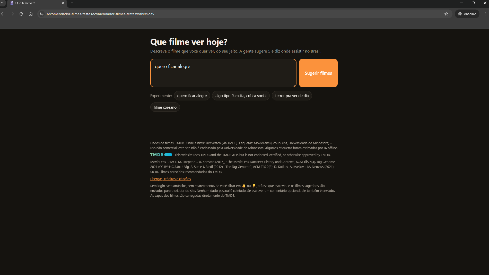
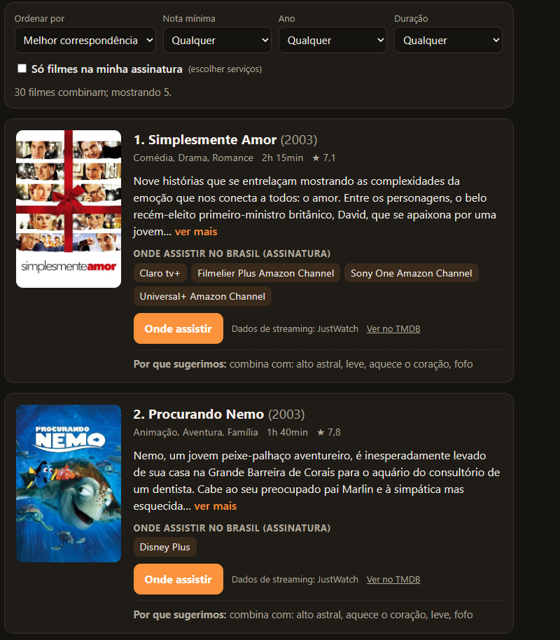
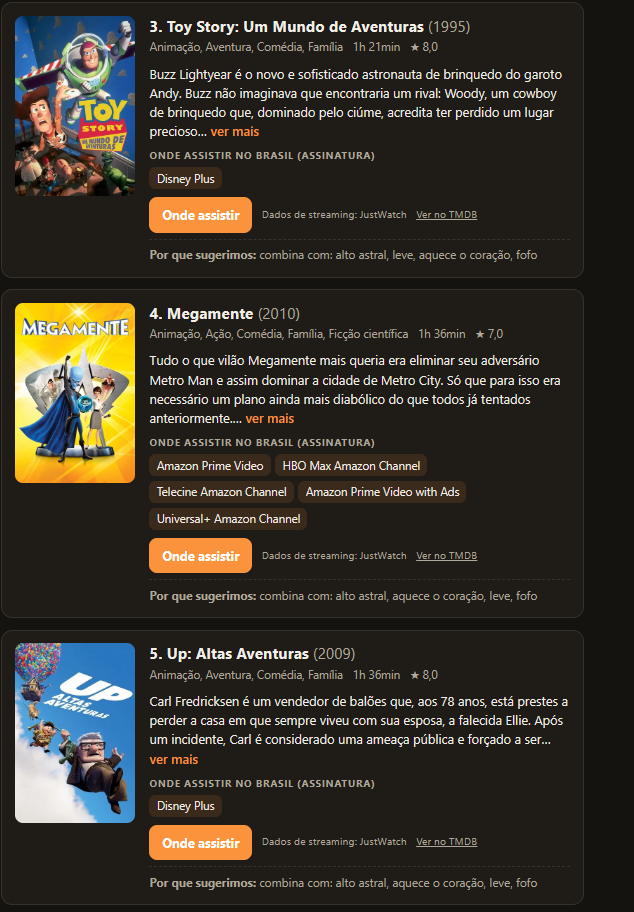
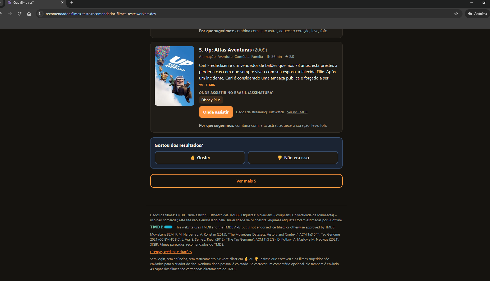

# Recomendador de filmes em português

> **Projeto sem fins lucrativos. Dados de terceiros não incluídos.**
Demo online (em teste): https://recomendador-filmes-teste.recomendador-filmes-teste.workers.dev

> Este repositório tem só o código, os conjuntos de pedidos de teste e os relatórios de método. Os dados de filmes (TMDB), de onde assistir (JustWatch) e do MovieLens não estão aqui; quem quiser rodar precisa baixá-los (veja "Como reproduzir").

Você escreve, do seu jeito, o filme que quer ver — *"quero algo pra ver chovendo, aconchegante"*, *"terror sem muito sangue"*, *"tipo Interestelar mas mais leve"*, *"comédia com o Adam Sandler"* — e recebe 5 sugestões, com onde assistir por assinatura no Brasil.

É um projeto de portfólio de dados com três regras:

- **Custo zero:** nenhum serviço pago. O site é estático (HTML + JavaScript) e roda inteiro no navegador.
- **Sem IA rodando no site:** a recomendação só cruza dados. Não há modelo de linguagem nem chamada a API na hora da busca.
- **Sem login, sem anúncios, sem rastreamento.** O feedback 👍/👎 só envia a frase pesquisada (e os filmes sugeridos) se a pessoa clicar.

---

## Prints

**Busca**



**Resultados (1 a 2)**



**Resultados (3 a 5)**



**Bloco de feedback**



---

## Como funciona (4 passos)

1. **Ler o pedido.** O texto é normalizado (minúsculas, sem acento, correção de erros de digitação comuns) e passa por um dicionário de cerca de 280 entradas e milhares de padrões que ligam o português do dia a dia ("soco no estômago", "desligar a cabeça", "fritar a cabeça") a 150 etiquetas de filmes (*twist ending*, *feel-good*, *dark*, *heist*...). O motor também reconhece negações ("sem muito sangue", "nada de susto"), gêneros, duração, época, nota, serviço de streaming, idioma, país, estúdio, pessoas (direção e elenco) e referências ("tipo Matrix", "entre Jurassic Park e Indiana Jones").
2. **Filtrar o catálogo.** Dos 6.000 filmes mais votados do TMDB, saem os que não passam nos filtros (gênero, duração, ano, nota, streaming, país, pessoa...). Em referências, o filme citado, sua série e sua coleção saem das respostas.
3. **Pontuar.** Cada filme recebe `0,7 × etiquetas + 0,3 × palavras-chave do TMDB`. As etiquetas vêm de três fontes, postas na mesma régua (posição percentual dentro de cada etiqueta e fonte): MovieLens Tag Genome 2021, etiquetas de usuários do MovieLens 32M (com uma tabela de sinônimos feita à mão) e etiquetas estimadas por IA **offline** para filmes recentes sem outra fonte (sempre marcadas como "estimadas"). Negações viram penalidade. Se nada no pedido é reconhecido, o motor tenta a sinopse (TF-IDF) e, por último, devolve filmes muito bem avaliados com um aviso.
4. **Mostrar.** O site mostra 5 filmes por vez (de 30 candidatos), com capa, sinopse curta, "por que sugerimos" e o link "Onde assistir" para a página do TMDB (dados do JustWatch). Dá para reordenar e filtrar (só minha assinatura, nota, ano, duração).

O motor existe em duas versões idênticas: `motor_t.py` (Python, usado para testar e medir) e `site/motor.js` (JavaScript, usado no site). Um teste automático confere que as duas devolvem o mesmo top 5, na mesma ordem, em 286 frases.

---

## Como medi a qualidade

A pergunta era: *para um pedido escrito por uma pessoa, quantos dos 5 filmes sugeridos servem?*

**Métrica principal: precisão@5** = fração dos 5 filmes que uma pessoa avaliou como "serve" (nota 1) ou "ótimo" (nota 2). Também acompanhei o **acerto** (pelo menos 1 filme bom no top 5) e o **NDCG@5** (que dá mais peso a filmes bons nas primeiras posições).

**Testes cegos.** O dicionário e os pesos foram ajustados em pedidos de desenvolvimento (1 a 110). Para medir sem me enganar, separei conjuntos de pedidos que o motor nunca viu, rodei **uma única vez** e congelei: depois de vistos, esses pedidos ficam **proibidos para ajuste** (estão marcados como "consumidos"). As versões do motor usadas em cada teste estão guardadas como `motor_t_vN_congelado.py`.

| teste | pedidos | o que comparou | resultado |
|---|---|---|---|
| Teste final com gabarito escrito | 91–110 (20) | T com etiquetas × T só com palavras-chave | acerto 50% × **60%** — as etiquetas **não** ajudaram |
| Teste cego 1 (notas humanas) | 111–140 (30) | motor T × motor A (só palavras-chave) | acerto **87%** × 77% |
| Teste cego 2 (notas humanas, por sinopse) | 141–170 (30) | T v4 × T v1 | precisão@5 **78%** × 74%; NDCG@5 0,84 × 0,81; acerto 30/30 nos dois |
| Teste cego de referência ("tipo X") | 171–190 (20) | só etiquetas × MovieLens + TMDB + etiquetas | precisão@5 **59%** × 58%; acerto 18 × 17 |

Os pedidos estão em `pedidos_*.csv` (só número, estilo e texto do pedido; os gabaritos e as notas não estão publicados porque trazem sinopses e listas de filmes do TMDB).

Houve também uma medição das expressões do dicionário num conjunto guardado antes (900 de 4.500 expressões, nunca usadas para montar o dicionário): a fração de expressões positivas que o motor entende passou de 31,6% para 49,9%, e a de negações de 40,7% para 68,7% (`resultados/relatorio_expressoes_antes_depois.txt`).

### Limitações (honestas)

- **Só eu avaliei** os testes cegos, e nos testes 141–200 os pedidos foram escritos pelo assistente de IA imitando o meu jeito de pedir. Não é uma amostra de usuários reais.
- **Os números não são comparáveis entre testes:** os conjuntos são diferentes e o critério mudou (no teste 1, filmes desconhecidos ficavam em branco; no teste 2, tudo foi julgado pela sinopse).
- **Conjuntos pequenos** (20–30 pedidos): cada pedido vale 3 a 5 pontos percentuais. Diferenças de 1 ou 2 pontos são ruído.
- **O acerto saturou** (30/30) e deixou de diferenciar versões; por isso a precisão@5 virou a medida principal.
- **Medição das expressões otimista:** treino e teste foram escritos pelo mesmo assistente de IA, ao mesmo tempo.
- **Catálogo enviesado:** dos 6.000 filmes, 5.218 são em inglês e só 10 são brasileiros.
- **13% dos filmes não têm etiqueta de nenhuma fonte** (quase todos de 2023 em diante) e dependem só das palavras-chave do TMDB.
- **Falhas conhecidas:** "terror sem sustos" ainda traz terror assustador; "tipo O Senhor dos Anéis" traz O Hobbit (coleções diferentes no TMDB); filmes da Pixar sem "Disney" nas produtoras passam em "não seja da Disney"; "de 2010 pra cá" vira só 2010; não há filtro de lugar ("se passa em Paris").

---

## O que não funcionou

- **Só a sinopse (TF-IDF + cosseno, "motor B"):** 32% de acerto no desenvolvimento. As palavras de quem pede ("tenso", "rir até doer") quase nunca aparecem nas sinopses. Ficou só como plano B quando nada é reconhecido.
- **Híbrido A + B ("H70") no catálogo grande:** ótimo com 2.000 filmes (69%), caiu para 51% com 6.000 — mais concorrentes para os mesmos acertos.
- **Dicionário ajustado demais:** no desenvolvimento, as etiquetas pareciam melhores; no teste final (91–110), o motor com etiquetas acertou 50% e o mesmo motor só com palavras-chave, 60%. Isso levou à regra dos testes cegos e às correções guiadas por avaliação humana.
- **Filtragem colaborativa do MovieLens para referências** ("quem gostou de X também gostou de Y"): pela regra definida *antes* do teste (ligar só se a precisão@5 subisse 5 pontos sem cair o acerto), ficou **desligada**. Ela favorece filmes populares: onde havia vizinhos, a precisão caiu de 69% para 57%. O código está pronto (`similaridade_ml.py`, pesos em `pesos_t_ml.json`).
- **Emprestar etiquetas dos vizinhos** (média das etiquetas dos filmes parecidos em palavras-chave) para filmes sem etiqueta: acerta o "tipo" de filme, mas não serve para ordenar por clima. Para isso, etiquetas estimadas por IA offline foram bem melhores (`resultados/diagnostico_tags.txt`, `resultados/piloto_resultado.txt`).
- **Lista fixa de populares** quando nada é reconhecido: agrada, mas não tem relação com o pedido. Virou o último recurso, com aviso.

---

## Como reproduzir

Você vai precisar de **Python 3**, **Node.js** (só para os testes do site) e da **sua própria chave do TMDB**. Nada de dados vem no repositório.

### 1. Instalar

```bash
pip install -r requirements.txt
```

### 2. Chave do TMDB

Crie uma conta em https://www.themoviedb.org/, peça uma chave de API (Configurações → API) e crie na pasta do projeto um arquivo `.env` com:

```
TMDB_KEY=seu_token_de_leitura_da_api
```

Os scripts mandam a chave como `Authorization: Bearer`, então use o **token de leitura da API (v4)**. O `.env` está no `.gitignore`: **nunca o versione**.

### 3. Baixar os dados do TMDB (geram arquivos locais, ignorados pelo git)

```bash
python fetch_filmes_v2.py        # 6.000 filmes -> filmes_v2.csv (~15 min; retoma se parar)
python buscar_posteres.py        # endereços das capas -> posters.csv (~30 min)
python buscar_creditos.py        # direção, elenco, países, estúdios -> creditos.csv (~30 min)
python buscar_recomendados.py    # recomendados do TMDB -> recomendados_tmdb.csv (~1 h)
```

Os Termos do TMDB permitem guardar esses dados por **no máximo 6 meses**; veja `ATUALIZAR_DADOS.md`.

### 4. Baixar os dados do MovieLens (GroupLens)

- **Tag Genome 2021:** https://grouplens.org/datasets/movielens/tag-genome-2021/ — extraia para `dados_externos/tag_genome/` os arquivos `raw/metadata.json`, `raw/tags.json` e `scores/glmer.csv`.
- **MovieLens 32M:** https://grouplens.org/datasets/movielens/32m/ — extraia `links.csv`, `tags.csv` e `movies.csv` para `dados_externos/ml32m/ml-32m/`; para os vizinhos (opcional), extraia `ratings.csv` para `dados_externos/ml32m/ratings/`.

Leia e respeite as licenças (uso não comercial; veja "Créditos e licenças").

### 5. Montar as etiquetas e os dados do site

```bash
python -I cruzar_tag_genome.py     # etiquetas.csv (Tag Genome)
python -I ml32m_sinonimos.py       # sinonimos_ml32m.csv (tabela de sinônimos do ml-32m)
python -I unificar_etiquetas.py    # etiquetas_unificadas.csv (as fontes na mesma régua)
python -I similaridade_ml.py       # opcional: vizinhos_ml.csv
python -I exportar_site.py         # gera site/data/
```

As etiquetas estimadas por IA (`etiquetas_ia.csv`, `etiquetas_ia_piloto.csv`) **não estão incluídas**. Sem elas, crie um `etiquetas_ia.csv` só com o cabeçalho `imdb_id,tag,score,origem` antes de rodar `unificar_etiquetas.py`; os filmes recentes ficarão só com as palavras-chave. Para gerá-las, `etiquetar_ia.py` monta os lotes (`selecionar`, `mostrar N`, `juntar`) com o vocabulário de `vocabulario_piloto.csv`; as notas de cada lote são escritas offline por um assistente de IA, uma única vez.

### 6. Rodar o site no computador

```bash
python -m http.server 8765 --bind 127.0.0.1
```

Abra http://127.0.0.1:8765/site/ (abrir o `index.html` direto pelo arquivo não funciona: o navegador bloqueia a leitura dos dados). A página `admin_local/admin.html` mostra a idade dos dados do TMDB e as frases não entendidas; ela **não** deve ser publicada.

O feedback 👍/👎 vem desligado. Para ligar com a sua própria planilha, veja `docs/FEEDBACK.md`.

### 7. Conferir

```bash
python -I site_teste/validar_site.py   # Python e JavaScript devem dar o mesmo top 5
python motor.py T desenvolvimento      # roda o motor T nos pedidos 1 a 90
```

Os gabaritos não estão publicados, então os comandos que calculam acerto contra gabarito precisam de uma coluna `boas_respostas` que você mesmo escreva.

### Organização do repositório

| caminho | o que é |
|---|---|
| `motor_t.py`, `dicionario_tags.py` | motor T (o do site) e o dicionário de expressões |
| `motor.py`, `dicionario.py` | motores antigos A (palavras-chave), B (sinopse) e H (híbrido) e o comando de medição |
| `fetch_filmes*.py`, `buscar_*.py` | downloads do TMDB |
| `cruzar_tag_genome.py`, `ml32m_*.py`, `unificar_etiquetas.py`, `similaridade_ml.py` | montagem das etiquetas e dos vizinhos |
| `exportar_site.py` | gera `site/data/` |
| `site/` | o site estático (sem `site/data/`) |
| `site_teste/` | testes de fidelidade Python × JS e testes no navegador |
| `rodar_*.py`, `comparar_*.py`, `avaliar_*.py`, `analise_*.py` | rodadas dos testes e comparações entre versões |
| `*_congelado.py`, `pesos_t*.json` | versões congeladas do motor usadas em cada teste |
| `pedidos_*.csv` | conjuntos de pedidos (sem gabarito) |
| `expressoes_*.csv`, `expressoes_lotes/` | as 4.500 expressões escritas offline e a divisão treino/teste |
| `resultados/` | relatórios de método e de resultados (contagens, métricas, títulos sugeridos; sem sinopses nem dados de streaming) |
| `docs/FEEDBACK.md` | como configurar o receptor de feedback |

---

## Papel de cada ferramenta

- **TMDB (API):** catálogo de 6.000 filmes, títulos e sinopses em português, gêneros, palavras-chave, notas, capas, créditos e recomendados.
- **JustWatch (via TMDB):** onde assistir no Brasil.
- **MovieLens Tag Genome 2021:** notas de relevância de etiquetas para ~3.350 filmes até 2014.
- **MovieLens 32M:** etiquetas escritas por usuários (cobre filmes até 2023) e notas para a filtragem colaborativa (testada e desligada).
- **Python (pandas, scikit-learn, snowballstemmer):** downloads, montagem dos dados, motor de referência e medições.
- **JavaScript puro:** o motor no navegador e a página; sem framework e sem servidor.
- **Claude (Anthropic), offline:** etiquetas estimadas para filmes recentes sem outra fonte, as 4.500 expressões do dicionário e parte dos pedidos de teste. Tudo foi gerado uma vez e salvo em arquivo; o site só lê o resultado.
- **Claude Code:** **o código foi escrito com apoio do Claude Code**, e as decisões de produto, as regras de medição e as avaliações humanas foram feitas por mim.
- **Google Apps Script (opcional):** recebe o feedback 👍/👎 numa planilha.
- **Cloudflare:** hospedagem estática gratuita.

---

## Créditos e licenças

**This website uses TMDB and the TMDB APIs but is not endorsed, certified, or otherwise approved by TMDB.**

- **TMDB** (The Movie Database): dados de filmes, sinopses, capas, créditos e recomendados. O logo em `site/img/tmdb-logo.svg` é marca do TMDB e aparece só para a atribuição exigida.
- **JustWatch:** dados de onde assistir, obtidos via TMDB.
- **MovieLens 32M** (GroupLens Research, Universidade de Minnesota): uso em pesquisa e não comercial; redistribuição só nas mesmas condições. Citação:
  > Harper, F. M., and Konstan, J. A. (2015). The MovieLens Datasets: History and Context. *ACM Transactions on Interactive Intelligent Systems (TiiS)* 5, 4: 19:1–19:19. https://doi.org/10.1145/2827872
- **MovieLens Tag Genome 2021** (GroupLens): licença **CC BY-NC 3.0**. Citações:
  > Vig, J., Sen, S., and Riedl, J. (2012). The tag genome: Encoding community knowledge to support novel interaction. *ACM Trans. Interact. Intell. Syst.*, 2(3):13:1–13:44. https://doi.org/10.1145/2362394.2362395
  >
  > Kotkov, D., Maslov, A., and Neovius, M. (2021). Revisiting the tag relevance prediction problem. In *Proceedings of the 44th International ACM SIGIR Conference on Research and Development in Information Retrieval*. https://doi.org/10.1145/3404835.3463019
- Este projeto **não é endossado** pela Universidade de Minnesota, pela GroupLens, pelo TMDB nem pelo JustWatch.
- **Etiquetas de origem "ia"** foram estimadas offline pelo Claude (Anthropic) e aparecem no site como "etiqueta estimada".

Os textos completos das licenças e citações estão em `site/LICENCAS.md` (e `site/LICENCAS.html`, no site).

**Código:** licença MIT (`LICENSE`), válida **só para o código próprio**. Dados, capas e marcas pertencem às suas fontes e seguem as licenças delas.

**Projeto sem fins lucrativos:** sem anúncios, doações ou plano pago.
